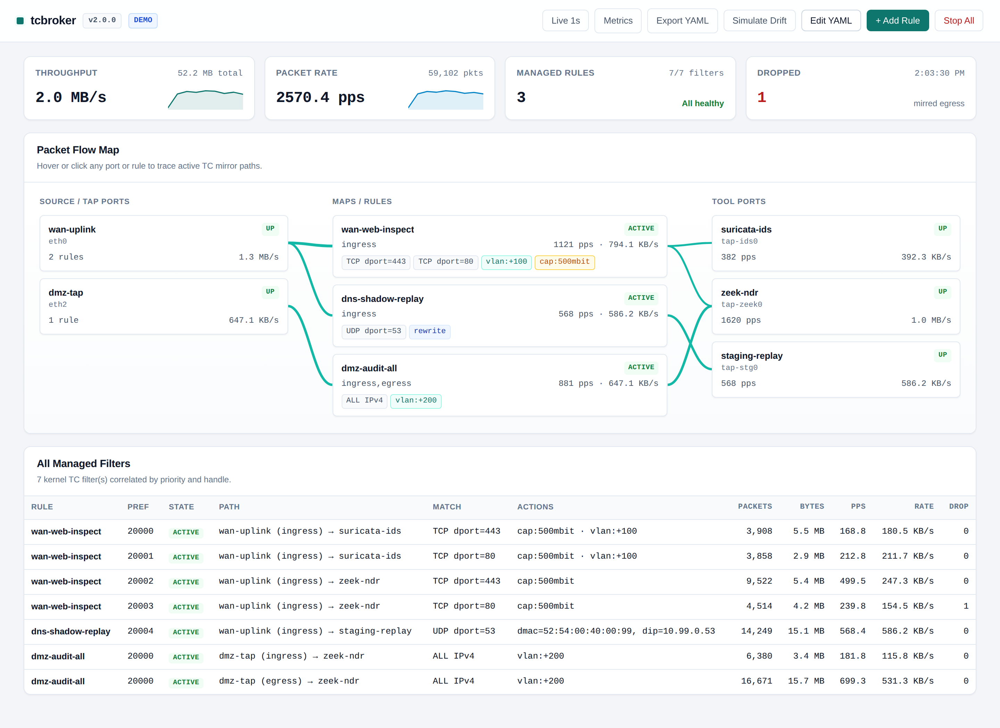

# tcbroker

A stateful, single-binary **mini Network Packet Broker (NPB)** for Linux Traffic Control (`tc`) with an embedded real-time WebUI and Prometheus `/metrics`.



## Features

- **Embedded Mini-NPB WebUI & Metrics (`tcbroker serve`)**: Zero-dependency `go:embed` dashboard (no external CDN) with 3-column SVG packet flow map, live PPS/bps sparklines, Dry-Run/Apply modals, YAML export, and Prometheus `/metrics`
- **Stateful & Config-less Operations**: Check `status`, monitor live rates (`--watch`), or `delete`/`stop` rules without passing the config file again
- **Idempotent Apply & Rollback**: Re-applying a config computes minimal changes, preserves counters on unchanged filters, and rolls back automatically on error
- **Safe Coexistence with Other TC Tools**: Tracks its own filters in a dedicated priority range (`20000–29999`) and never deletes external TC filters or pre-existing `clsact` qdiscs
- **NPB Packet Conditioning**: Supports port labels (`ports:`), non-destructive VLAN tag push/pop (`vlan:`), non-dropping mirror bandwidth caps (`rate_limit:`), MAC/IP header rewriting (`rewrite:`), `ingress`/`egress`/`both`, and strict typo validation
- **Drift Detection**: Detects if managed filters were removed externally and restores them on the next `apply` or one-click `Reconcile`

## Quick Start

### Installation

**Pre-built Binaries (Linux amd64 / arm64):**
Download the latest archive from [GitHub Releases](https://github.com/shmuto/tcbroker/releases).

**Docker (GHCR multi-arch `linux/amd64`, `linux/arm64`):**
```sh
docker pull ghcr.io/shmuto/tcbroker:latest
```

**From Source:**
```sh
git clone https://github.com/shmuto/tcbroker.git
cd tcbroker
make build
```

### Basic Usage

**1. Generate a starter configuration**

```sh
./tcbroker init tcbroker.yaml
```

**2. Edit `tcbroker.yaml`**

```yaml
ports:
  eth0:
    label: wan-uplink
    role: tap
  eth1:
    label: suricata-ids
    role: tool
  eth2:
    label: zeek-ndr
    role: tool

rules:
  # Minimal: mirror all IPv4 ingress packets from eth0 to eth1
  - name: mirror-all
    src: eth0
    dst: eth1

  # Filter HTTP/HTTPS, tag with VLAN 100, and cap mirror rate at 500mbit
  - name: web-traffic
    src: eth0
    direction: ingress # ingress (default) | egress | both
    rate_limit:
      rate: 500mbit
    dst:
      - intf: eth1
        vlan:
          push: 100
      - eth2
    filters:
      - proto: tcp
        dst_port: 80
      - proto: tcp
        dst_port: 443
```

**3. Validate, Preview, Apply & Monitor**

```sh
# Validate syntax, semantics, and interface existence
./tcbroker validate tcbroker.yaml --check-interfaces

# Preview diff and tc commands without root privileges
./tcbroker apply tcbroker.yaml --dry-run

# Apply configuration (idempotent; requires root)
sudo ./tcbroker apply tcbroker.yaml

# Check status and counters (no config file needed)
./tcbroker status

# Inspect a single rule in detail or monitor live PPS/bps
./tcbroker status web-traffic
./tcbroker status --watch

# Delete a single rule, or stop all tcbroker-managed rules
sudo ./tcbroker delete web-traffic
sudo ./tcbroker stop
```

## Commands

| Command | Description |
|---|---|
| `tcbroker init [file]` | Generate a starter YAML configuration (`-` prints to stdout; `-f`/`--force` overwrites) |
| `tcbroker validate <config>` | Strictly validate YAML syntax/semantics (`--check-interfaces`) |
| `tcbroker apply <config>` | Idempotently apply rules with rollback on error (alias: `start`; supports `--dry-run`) |
| `tcbroker status [rule]` | Show rule health and counters (`--watch`/`-w`, `--interval`, `--json`, `--raw`, `--all`) |
| `tcbroker delete [rule...]` | Delete specific rule(s) or all managed rules with `--all` (aliases: `stop`, `rm`; `stop` without args deletes all; supports `--dry-run`) |
| `tcbroker serve` | Start embedded mini-NPB WebUI, REST API, and Prometheus `/metrics` (alias: `ui`; supports `--listen`, `--read-only`, `--token`, `--demo`) |
| `tcbroker version` | Print version information |

### Try It Live with Real Linux TC (Docker Playground)

Want to see real Linux kernel TC mirroring, VLAN tagging, MAC/IP rewriting, and live WebUI counters without modifying your host network? Run the self-contained single-container playground (uses internal `ip netns`, so it works identically on **Linux, macOS, and Windows** with Docker alone — no Containerlab or host `sudo` needed):

```sh
# Build and start the real Linux TC playground (WebUI at http://localhost:8080)
make playground
# or: docker compose -f playground/compose.yaml up --build
```

While running, inspect real mirrored packets in another terminal:

```sh
# See VLAN 100 tagged HTTP packets arriving at the IDS namespace
docker exec -it tcbroker-playground ip netns exec ids tcpdump -i ids0 -e -nn -c 10

# See MAC/IP rewritten UDP/53 packets arriving at the staging namespace
docker exec -it tcbroker-playground ip netns exec stg tcpdump -i stg0 -e -nn -c 10

# Run CLI commands directly against live kernel TC
docker exec -it tcbroker-playground tcbroker status --watch
```

### Mini-NPB WebUI & Prometheus Metrics

`tcbroker` embeds a zero-dependency WebUI (`go:embed`, no external CDN) and Prometheus `/metrics` endpoint in the same single binary:

```sh
# Try immediately with simulated live traffic (no root required)
./tcbroker serve --demo

# Read-only monitoring UI + /metrics (no root required)
./tcbroker serve --read-only --listen 127.0.0.1:8080

# Full interactive mini-NPB mode with API token protection
sudo ./tcbroker serve --listen 127.0.0.1:8080 --token "$TCBROKER_API_TOKEN"
```

### Docker Usage (Minimal Privilege)

```sh
# Apply rules (mount /run/tcbroker so state persists across container runs)
docker run --rm --cap-add=NET_ADMIN --network host \
  -v /run/tcbroker:/run/tcbroker \
  -v $(pwd)/tcbroker.yaml:/config/tcbroker.yaml:ro \
  ghcr.io/shmuto/tcbroker:latest apply /config/tcbroker.yaml

# Run the mini-NPB WebUI + /metrics in a container
docker run --rm --cap-add=NET_ADMIN --network host \
  -v /run/tcbroker:/run/tcbroker \
  ghcr.io/shmuto/tcbroker:latest serve --listen 127.0.0.1:8080
```

### Global Flags

- `--state-file <path>` - Override state file path (default: `/run/tcbroker/state.json`, or `$TCBROKER_STATE_FILE`)
- `--debug` - Print all executed `tc` commands

## Configuration Reference

```yaml
ports:                          # Optional: human-readable labels shown in status & WebUI
  eth0:
    label: wan-uplink
    role: tap                   # Optional: tap | tool
    description: External tap   # Optional
  eth1:
    label: suricata-ids
    role: tool

rules:
  - name: <string>              # Required: unique rule identifier
    src: <string>               # Required: source interface
    direction: <ingress|egress|both> # Optional: default "ingress"
    rate_limit:                 # Optional: non-dropping mirror bandwidth cap
      rate: <e.g. 500mbit>
      burst: <e.g. 1mb>         # Optional: default 1mb
    vlan:                       # Optional: default VLAN op for all destinations
      push: <1-4094>            # Pushed on mirror copy, popped on original packet
      # pop: true               # Or strip outer VLAN tag before mirroring
    dst:                        # Required: string, list of strings, or list of objects
      - <intf>
      - intf: <string>
        vlan:                   # Optional: overrides rule-level vlan
          push: <1-4094>
        rate_limit:             # Optional: overrides rule-level rate_limit
          rate: <e.g. 100mbit>
        rewrite:                # Optional: overrides rule-level rewrite for this target
          dst_mac: <mac>
          src_mac: <mac>
          dst_ip: <ipv4>
          src_ip: <ipv4>
    rewrite:                    # Optional: default rewrite for all destinations in this rule
      dst_mac: <mac>
      src_mac: <mac>
      dst_ip: <ipv4>
      src_ip: <ipv4>
    filters:                    # Optional: omit to match all IPv4 traffic
      - proto: <tcp|udp|icmp>
        src_ip: <ipv4|cidr>
        dst_ip: <ipv4|cidr>
        src_port: <1-65535>     # Requires proto: tcp or udp
        dst_port: <1-65535>     # Requires proto: tcp or udp
```

## How It Works

1. Ensures a `clsact` qdisc exists on each `src` interface and records whether `tcbroker` created it.
2. Allocates dedicated `flower` filter priorities in `20000–29999` (skipping any priority already used by external tools) with explicit handles (`0x1`).
3. Applies optional `police` (`conform-exceed continue/pipe`, capping mirror bandwidth without dropping original traffic), `skbmod` (MAC rewrite), `pedit` + `csum ip4h` (IPv4 rewrite + checksum recalculation), and `vlan` (`push` → `mirred` → `pop` so original packets continue untagged), followed by `mirred egress mirror ... continue`.
4. Persists ownership metadata atomically to `/run/tcbroker/state.json` (mode `0644` so non-root users can run `status` and `serve --read-only`).
5. On `delete`/`stop`, removes only `tcbroker`-owned filters by priority/handle, and removes `clsact` only if `tcbroker` created it and no other filters remain.

## Testing

```bash
# Unit tests
make test

# Build binary
make build

# Docker integration tests
make docker-test
```

## Documentation

- [Product Vision & Roadmap](docs/product-vision.md) - Mini-NPB positioning, deployment strategy, WebUI design, and phased roadmap
- [Architecture](docs/architecture.md) - System design, TC packet pipeline, and reconciliation diagrams
- [Changelog](CHANGELOG.md) - Release history

## License

MIT License - see [LICENSE](LICENSE) for details.
