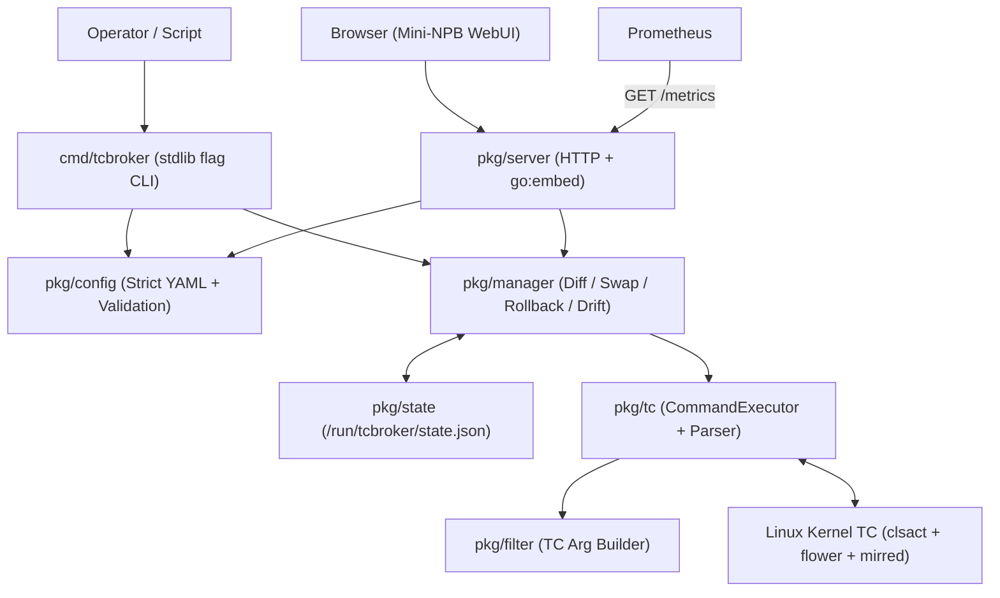
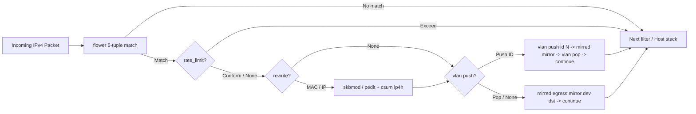
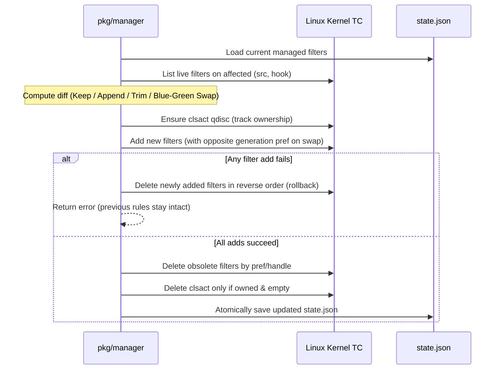

# tcbroker Architecture

## 1. System Overview

`tcbroker` is a stateful mini-NPB (Network Packet Broker) built directly on Linux Traffic Control (`tc`) with a single Go dependency (`gopkg.in/yaml.v3`). Both the CLI and the embedded WebUI/API share the same `pkg/manager` engine and `/run/tcbroker/state.json` state file.

## 2. Package Responsibilities

| Package | Responsibility |
|---|---|
| `cmd/tcbroker` | Zero-dependency CLI (`apply`, `status`, `delete`/`stop`, `validate`, `init`, `serve`/`ui`, `version`) using standard library `flag` with flexible argument ordering |
| `pkg/config` | Declarative YAML schema (`ports`, `rules`, flexible `dst`, optional `filters`, `vlan`, `rate_limit`, `rewrite`), strict `KnownFields` decoding, validation, and operational warnings |
| `pkg/filter` | Builds exact `tc filter add/del` argument lists with `pref`/`handle`, safe non-dropping `police`, `skbmod`/`pedit`/`csum`, non-destructive `vlan push`+`pop`, and `mirred egress mirror` |
| `pkg/state` | Atomic JSON persistence (`0644` for non-root `status`), deterministic spec hashing, and `ExportConfig()` / `ExportYAML()` reconstruction |
| `pkg/tc` | Injectable `CommandExecutor` abstraction, read/write `Runner`, targeted `clsact` qdisc & `flower` filter operations, and `tc -s filter show` parser |
| `pkg/manager` | Stateful reconciliation engine: idempotent diffing, two-generation blue/green priority swap (`20000–24999` ↔ `25000–29999`), rollback on failure, external-tool coexistence, and drift detection |
| `pkg/server` | Optional embedded HTTP server (`tcbroker serve`) hosting the 3-column SVG topology WebUI, REST API (with `--read-only` and Bearer `--token` guards), Prometheus `/metrics`, and `--demo` simulator |

## 3. Packet Processing Pipeline inside Linux TC

Each managed rule expands into one or more `flower` filters attached to the source interface's `clsact` qdisc (`ingress` and/or `egress` hook):

Key safety guarantees:
- **Non-dropping rate cap**: `action police ... conform-exceed continue/pipe` skips only the mirror action when exceeding the cap; original production traffic is never dropped.
- **Non-destructive VLAN push**: `vlan push id <ID> pipe` → `mirred egress mirror ... pipe` → `vlan pop continue` tags only the mirrored copy while leaving the original packet unmodified.
- **External tool safety**: Dedicated priority range `20000–29999` (skipping any priority already used externally). Cleanup removes only `tcbroker`-owned priorities and only removes `clsact` if `tcbroker` created it and no filters remain on either hook.

## 4. Idempotent Reconciliation & Rollback

