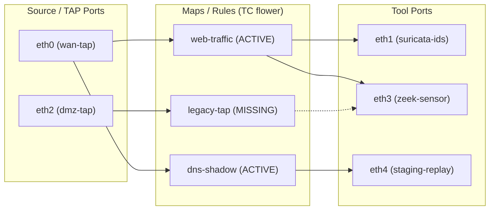

# tcbroker Product Vision & Roadmap

## 1. Product Vision

**`tcbroker` は、Linux カーネル（TC）の力を活かした「単一バイナリ / 軽量コンテナで動くミニ NPB（Network Packet Broker）」を目指すプロダクトです。**

商用 NPB（Gigamon / Keysight / Arista DANZ 等）は高機能である一方、高価かつ専用機器・重厚な構成になりがちです。一方、汎用 Linux の `tc` コマンドは強力ですが、直接扱うには構文が難解で、状態管理・監視・安全なロールバックが欠けています。

`tcbroker` はそのギャップを埋め、**「既存 Linux ホストやコンテナ環境にポンと置いて、安全にパケットを選別・加工・複製し、リアルタイムに可視化できる超軽量ソフトウェア NPB」** を提供します。

---

## 2. ポジショニング

| 選択肢 | 強み | 課題 |
|---|---|---|
| **商用 NPB** (Gigamon 等) | 100Gbps+ ラインレート、高度な L2-L7 加工、リッチな GUI | 非常に高価、専用アプライアンス前提、ラボや小〜中規模環境には過剰 |
| **L2/L3 スイッチの SPAN** | ハードウェア処理で高速 | 細かい 5 タプル選別やヘッダ書き換えが弱い、クラウド/仮想環境では使いにくい |
| **ユーザー空間ツール** (`tcpdump` / プロキシ等) | 柔軟、導入が簡単 | カーネル→ユーザー空間コピーによる CPU 負荷・パケットドロップが発生しやすい |
| **`tcbroker` (ミニ NPB)** | **カーネル空間処理（低負荷）、単一バイナリ (~5MB)・依存最小、5 タプル選別＋ヘッダ書き換え、安全な状態管理** | 100Gbps 級のハードウェア専用処理や L7 ディープインスペクションは対象外 |

---

## 3. ターゲットユーザーと主要ユースケース

### 想定ユーザー
- **ネットワーク / インフラエンジニア**: オンプレ・仮想環境・Linux ルータで柔軟なトラフィック分岐や SPAN を組みたい
- **セキュリティ / SOC 運用者**: IDS/NDR（Suricata / Zeek / Arkime 等）の前段で不要トラフィックを間引き、複数センサーへ安全に配りたい
- **SRE / 開発者**: 障害調査時のオンデマンド TAP や、本番 UDP トラフィックの検証環境へのシャドウイングを行いたい

### 代表的なユースケース
1. **軽量ソフトウェア NPB（監視・セキュリティ基盤の前段）**  
   全量ミラーでは処理しきれない IDS/解析サーバに対し、必要なサブネット・プロトコル・ポートだけを選別して複数宛先へ複製する。
2. **本番 UDP トラフィックのシャドウイング**  
   DNS / Syslog / NetFlow / メトリクス / IoT などの UDP 通信を、本番経路に影響を与えずに `dst_ip` / `dst_mac` 書き換え付きでステージング環境へ複製する。
3. **オンプレ・仮想環境でのソフトウェア SPAN**  
   ミラー機能が乏しいスイッチや仮想基盤上の Linux ゲートウェイで、宣言的にミラーポートを構成する。
4. **コンテナ / Kubernetes 環境のオンデマンド TAP**  
   アプリコンテナを再起動せず、対象コンテナと同一の Network Namespace に差し込んで特定トラフィックを解析コンテナへ複製し、調査後にクリーンに撤去する。
5. **ネットワーク検証ラボ（Containerlab / veth 等）**  
   再現可能な YAML でトラフィック複製・ヘッダ書き換えを含む検証トポロジを自動構築する。

---

## 4. 配布・実行形態の戦略

**「コアは単一静的バイナリ、コンテナは用途別の選択肢」** という二刀流を基本方針とします。

| 実行形態 | 向いている環境 | 運用上のポイント |
|---|---|---|
| **単一バイナリ + CLI / systemd** | ベアメタル Linux、VM、Linux ルータでの常設 | 約 5MB・外部依存は `yaml.v3` のみ。設定適用後に常駐プロセスが残らない（メモリ消費 0）のが最大の強み |
| **Docker コンテナ / K8s DaemonSet** | Immutable OS、Kubernetes 基盤、他コンテナのデバッグ | `--cap-add=NET_ADMIN`（最小権限）と `--network host`（または `--network container:<target>`）を使用。**状態永続化のため `/run/tcbroker` のホストマウントが必須** |

---

## 5. WebUI 構想（`tcbroker serve`）

ミニ NPB としての体験を完成させるため、**オプション起動の軽量 WebUI** を提供します。

### WebUI の設計原則
1. **常駐を強制しない**: 普段の CLI 運用（適用して即終了）を壊さず、可視化・操作が必要なときだけ `tcbroker serve` を起動する。
2. **単一バイナリ内蔵・閉域網対応**: フロントエンドは `go:embed` でバイナリに埋め込み、外部 CDN に一切依存しない（エアギャップ環境でもそのまま動作）。
3. **CLI との完全同期（Single Source of Truth）**: WebUI の操作もすべて `pkg/manager` と `state.json` を経由するため、CLI の `apply` / `status` / `delete` と状態が絶対にズレない。UI で組んだ構成の **YAML エクスポート** にも対応し、GitOps へ移行できる。
4. **セキュア・バイ・デフォルト**:
   - デフォルトは `127.0.0.1` バインド（SSH ポートフォワード前提）
   - 閲覧専用の `--read-only` モードは非 root で動作可能
   - 編集を有効にする場合はトークン認証（`--token`）または明示的なオプトインを要求
5. **可観測性の標準化**: 同じ HTTP サーバに Prometheus 互換の `/metrics` エンドポイントも併設し、Grafana 等の既存監視基盤にすぐ載せられるようにする。

---

## 6. プロダクト原則と Non-Goals

### 守るべき原則
- **他ツールを壊さない**: 専用 `pref` レンジと所有権トラッキングにより、他ツールや手作業で入れた TC 設定を絶対に削除しない。
- **冪等性とロールバック**: 何度適用しても安全で、失敗時に中途半端な状態を残さない。
- **最小依存・軽量維持**: 依存ライブラリを極力増やさず、ビルド・配布の手軽さを保つ。

### Non-Goals（意図的にやらないこと）
- L7 ディープパケットインスペクション（HTTP/TLS ペイロード解析や SSL 復号）
- ステートフルな TCP プロキシ / ロードバランサ機能
- 専用ハードウェアや DPDK ベースの 100Gbps+ ラインレート処理の代替

---

## 7. 段階的ロードマップ

### Phase 1: Stateful CLI & 安全適用基盤（完了 ✅）
- 状態管理（`state.json`）と専用 priority レンジ（`20000–29999`）による安全な TC 管理
- 冪等な `apply`、Blue-Green 世代スワップ、失敗時ロールバック、ドリフト検知
- 設定ファイル不要の `status`（`--watch` / `--json` / `--raw`）と `delete` / `stop`
- 刷新された YAML スキーマ（複数宛先・方向指定・省略可能 `filters`・厳密バリデーション）
- 標準ライブラリ `flag` 化による最小依存構成（外部依存は `yaml.v3` のみ）

### Phase 2: ミニ NPB WebUI MVP & Observability（次期フォーカス）
- `tcbroker serve` サブコマンド（`go:embed` 内蔵ダッシュボード）
  - 3 カラム結線ビュー（Source Ports → Rules → Tool Ports）
  - リアルタイム PPS / bps 推移グラフ・ドロップ監視・ドリフト警告 & ワンクリック修復
  - ルールの追加・編集・削除・YAML エクスポート
  - `--read-only` モード & 簡易トークン認証
- Prometheus `/metrics` エンドポイント（ルール・フィルタ単位の packets / bytes / dropped / health）
- Docker イメージの `NET_ADMIN` 最小権限運用ガイド & `/run/tcbroker` マウント対応

### Phase 3: NPB パケット加工・運用機能の強化
- **ポートエイリアス（Labels）**: NIC 名に役割名・説明を付与（例: `eth0` → `wan-uplink`）
- **VLAN タグ操作（`vlan push` / `pop`）**: 複数タップ元を集約する際の入力元識別タグ付与
- **レート制限 / サンプリング（`police` / `sample`）**: 高トラフィック時のセンサー保護
- **宛先 MAC / 出力 IF の自動解決**: ルーティングテーブル・ARP 参照により `dst_mac` の手書きを不要化

### Phase 4: 遠隔ミラー & マルチノード拡張
- **カプセル化宛先（VXLAN / GRE / ERSPAN）**: L2 直結していない遠隔ホスト・クラウド上の監視基盤へのミラー転送
- **マルチノード集約（オプション）**: 複数ホストの `tcbroker` を束ねて監視・設定配布できる軽量コントローラ構成
